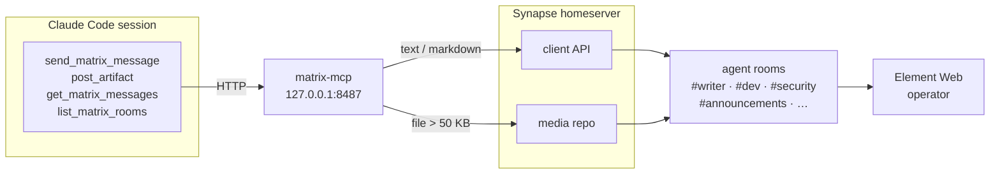

# matrix-mcp

FastMCP server providing Matrix homeserver communication tools for forge agent sessions.



## Tools

| Tool | Description |
|------|-------------|
| `send_matrix_message` | Send a message to a named agent room |
| `get_matrix_messages` | Fetch recent messages from a room |
| `list_matrix_rooms` | List all agent rooms with IDs |
| `post_artifact` | Post a file's contents to a room (markdown rendered as HTML; >50KB uploaded as attachment) |

Room names are short names (`dev`, `task-queue`, `approvals`, etc.) — no `#` or `!` prefix needed.

## Rooms

| Short name | Env var | Purpose |
|------------|---------|---------|
| `sysadmin` | `MATRIX_ROOM_SYSADMIN` | Sysadmin agent activity |
| `research` | `MATRIX_ROOM_RESEARCH` | Research agent activity |
| `developer` | `MATRIX_ROOM_DEV` | Developer agent activity |
| `security` | `MATRIX_ROOM_SECURITY` | Security audit findings |
| `writer` | `MATRIX_ROOM_WRITER` | Writer agent activity |
| `alerts` | `MATRIX_ROOM_ALERTS` | System alerts and notifications |
| `agents` | `MATRIX_ROOM_AGENTS` | Cross-agent coordination |
| `announcements` | `MATRIX_ROOM_ANNOUNCEMENTS` | System-wide announcements |
| `harlock` | `MATRIX_ROOM_HARLOCK` | Harlock personal agent — primary Matrix interface |
| `vikunja` | `MATRIX_ROOM_VIKUNJA` | Vikunja task/webhook notifications |

## Setup

matrix-mcp is not a package: PM2 runs `venv/bin/fastmcp run server.py` from the checkout,
and `server.py`, `client.py` and `room_map.py` import from there. The script below builds
`venv/` from a fresh clone of a release tag, using that clone's committed `uv.lock`, so the
dependency set is the one CI tested and audited. Nothing of the project itself is installed
(`--no-install-project`), so the code that runs is the checkout's, and the check that
matters is that the checkout is byte-for-byte the release. Use [uv](https://docs.astral.sh/uv/).
`ecosystem.forge.config.json` expects the venv this script builds.

Save this as a script and run it with `bash`. Don't paste it into a shell: every check ends
the run on failure, and that only works under `set -e` in a script.

```bash
#!/usr/bin/env bash
set -euo pipefail
VERSION=0.3.0
URL=https://github.com/TadMSTR/matrix-mcp
# The directory the service runs from: ecosystem.forge.config.json `cwd`.
REPO=${REPO:-$HOME/repos/personal/matrix-mcp}
PY=/usr/bin/python3.13
die() { echo "install: $*" >&2; exit 1; }
tmp=$(mktemp -d) && trap 'rm -rf -- "$tmp"' EXIT
# Git without the system or global config, hooks or fsmonitor. A command run inside the
# checkout, or against its .git, still reads the checkout's own .git/config.
gx() {
  GIT_CONFIG_NOSYSTEM=1 GIT_CONFIG_GLOBAL=/dev/null \
    git -c core.fsmonitor=false -c core.hooksPath=/dev/null "$@"
}

# 0. Stop the service and move its venv aside (outside the checkout) BEFORE this runs.
#    The service runs the checkout's source, so updating the checkout under a running
#    service would change the code it runs.
[ -d "$REPO/.git" ] || gx clone --quiet "$URL" "$REPO"
cd "$REPO" || die "cannot enter $REPO"
[ ! -e venv ] || die "venv exists: move it aside first (and stop the service if it is running)"

# 1. The release, fresh from the network. The dependency set comes from this clone, never
#    from the checkout: a long-lived checkout's index, config and object store can all
#    misreport what it holds. The tag's commit is read from the same URL.
tag=$(gx ls-remote "$URL" "refs/tags/v$VERSION" "refs/tags/v$VERSION^{}" | tail -n1 | cut -f1)
[ -n "$tag" ] || die "tag v$VERSION is not on $URL"
gx clone --quiet --depth 1 --branch "v$VERSION" "$URL" "$tmp/src"
[ "$(gx -C "$tmp/src" rev-parse HEAD)" = "$tag" ] || die "fresh clone is not v$VERSION ($tag)"

# 2. The checkout PM2 runs from is the code that runs, so it must be exactly the release.
#    Move it to the tag, remove bytecode and tool caches (Python loads a cached .pyc whose
#    header matches the source, and git status does not show ignored files), then compare
#    every file with the fresh clone, byte for byte, in Python: no git status, index or
#    config is trusted. Only venv/ is skipped. A `.env` fails the check: fastmcp reads one
#    from its working directory for FASTMCP_* settings, and credentials come from ENV_FILE.
gx --git-dir="$REPO/.git" --work-tree="$REPO" fetch --quiet "$URL" "refs/tags/v$VERSION"
gx --git-dir="$REPO/.git" --work-tree="$REPO" checkout --quiet --detach "$tag"
find . -path ./.git -prune -o -path ./venv -prune -o \
  \( -name __pycache__ -o -name '*.py[co]' \) -print0 | xargs -0 -r rm -rf --
rm -rf .pytest_cache .ruff_cache .coverage htmlcov
"$PY" -I - "$REPO" "$tmp/src" venv <<'EOF' || die "checkout differs from v$VERSION; fix the files listed above"
import os, sys, pathlib
# argv: <live checkout> <fresh clone> <top-level names to skip in the live checkout>...
live, ref, skip = pathlib.Path(sys.argv[1]), pathlib.Path(sys.argv[2]), set(sys.argv[3:])

def entries(root, top_skip):
    out = {}
    for d, dirs, files in os.walk(root):
        rel = pathlib.Path(d).relative_to(root)
        if rel == pathlib.Path("."):
            dirs[:] = [x for x in dirs if x not in top_skip]
            files = [x for x in files if x not in top_skip]
        for x in [x for x in dirs if (pathlib.Path(d) / x).is_symlink()]:
            dirs.remove(x)
            files.append(x)
        for f in files:
            out[(rel / f).as_posix()] = pathlib.Path(d) / f
    return out

def same(a, b):
    if a.is_symlink() or b.is_symlink():
        return a.is_symlink() and b.is_symlink() and os.readlink(a) == os.readlink(b)
    return a.is_file() and b.is_file() and a.read_bytes() == b.read_bytes()

have, want = entries(live, skip | {".git"}), entries(ref, {".git"})
extra, missing = sorted(have.keys() - want.keys()), sorted(want.keys() - have.keys())
differ = sorted(k for k in have.keys() & want.keys() if not same(have[k], want[k]))
if extra or missing or differ:
    sys.exit(f"extra: {extra}\nmissing: {missing}\ndiffer: {differ}")
print(f"install: checkout matches the release, {len(want)} files")
EOF

# 3. Build a fresh venv at the path the service runs from, from the clone's own
#    pyproject.toml and uv.lock. Pin the interpreter: uv otherwise prefers a Python it
#    manages itself, which `uv python` can later remove or replace under a running
#    service. --no-config: no uv.toml outside the project. --no-cache: nothing an earlier
#    run cached.
UV_PROJECT_ENVIRONMENT="$REPO/venv" uv sync --project "$tmp/src" --no-config \
  --frozen --no-install-project --no-dev --no-cache --python "$PY"

# 4. The venv is exactly the lock: no missing, extra or different package.
UV_PROJECT_ENVIRONMENT="$REPO/venv" uv sync --project "$tmp/src" --no-config \
  --frozen --no-install-project --no-dev --python "$PY" --check \
  || die "venv does not match uv.lock"
# The server imports from the checkout and its dependencies from the venv, the way PM2
# starts it. server.py exits without its MATRIX_* variables; placeholders are enough to
# import, and ENV_FILE=/dev/null keeps the real credentials out of this check.
ENV_FILE=/dev/null venv/bin/python -I - "$REPO" <<'EOF' || die "import check failed"
import os, pathlib, re, sys
repo = pathlib.Path(sys.argv[1])
src = "".join((repo / f).read_text() for f in ("server.py", "room_map.py"))
for name in set(re.findall(r'"(MATRIX_[A-Z_]+)"', src)):
    os.environ[name] = "import-check"
sys.path.insert(0, str(repo))
import fastmcp, nio, server
assert pathlib.Path(server.__file__).resolve() == (repo / "server.py").resolve(), server.__file__
for mod in (fastmcp, nio):
    assert "/venv/lib/" in mod.__file__, mod.__file__
print("install: server.py from", server.__file__, "| fastmcp", fastmcp.__version__)
EOF
[ ! -e venv/bin/pip ] || die "venv has pip; it was not built by this script"
echo "install: matrix-mcp v$VERSION ready; restart the service by name"
```

Build a fresh venv rather than installing into an existing one: an install into an existing
venv keeps whatever older dependency versions it finds there, if they still satisfy the
declared ranges. Build at the final path rather than building elsewhere and moving it: the
venv's scripts embed its path (PM2 runs `venv/bin/fastmcp`). A uv-built venv has no `pip`.
Stop the service and move its venv aside before running the script (step 0 refuses to run
otherwise), and restart it by name (`pm2 restart matrix-mcp-forge`) only after the script
prints `ready`.

If the script stops early, it leaves the service stopped, and nothing puts it back. What it
leaves depends on where it stopped:

- **Before step 2** (the tag or the fresh clone): the checkout and the old venv are as they
  were. Move the old venv back and restart.
- **Step 2 or later:** the checkout is detached at the release tag, and from step 3 a `venv/`
  may exist that never passed the step 4 checks. Don't start the service on it. Move that
  `venv/` aside, move the old venv back, check out the commit the service ran before
  (`git checkout <previous commit>`), then restart.

Don't run the script again until `venv/` is gone: the check at step 0 refuses while it exists.

CI audits the locked set on every push and weekly, but nothing reads a scheduled run's
result unless you watch it, and GitHub disables a public repository's scheduled workflows
after 60 days without activity. Audit the deployed venv where it runs as well (for example
`pip-audit --path venv/lib/python3.13/site-packages`).

Credentials are loaded from `~/.claude-secrets/matrix.env` (or the path in `ENV_FILE`). Required vars:

```
MATRIX_HOMESERVER_URL=https://matrix.example.com
MATRIX_BOT_USER_ID=@bot:example.com
MATRIX_ACCESS_TOKEN=<bot token>
MATRIX_ROOM_SYSADMIN=!...:example.com
MATRIX_ROOM_RESEARCH=!...:example.com
MATRIX_ROOM_DEV=!...:example.com
MATRIX_ROOM_SECURITY=!...:example.com
MATRIX_ROOM_WRITER=!...:example.com
MATRIX_ROOM_ALERTS=!...:example.com
MATRIX_ROOM_AGENTS=!...:example.com
MATRIX_ROOM_ANNOUNCEMENTS=!...:example.com
MATRIX_ROOM_HARLOCK=!...:example.com
MATRIX_ROOM_VIKUNJA=!...:example.com
```

All room vars are validated at startup — the server exits immediately if any are missing or empty.

## Running

### PM2 (production)

```bash
pm2 start ~/repos/personal/matrix-mcp/ecosystem.config.json
pm2 save
```

### Manual

```bash
cd ~/repos/personal/matrix-mcp
ENV_FILE=~/.claude-secrets/matrix.env venv/bin/fastmcp run server.py --transport http --host 127.0.0.1 --port 8487
```

## Development

```bash
uv sync --frozen
uv run --frozen --no-sync pytest --cov=. --cov-report=term-missing
uv run --frozen --no-sync ruff check .
uv run --frozen --no-sync ruff format .
```

Dependency ranges and security floors are in `pyproject.toml`; `uv.lock` is the set CI
tests and audits and the install script deploys. After changing a range, run `uv lock`
and commit both files.

## Claude Project Integration

Add to `~/.claude.json` global MCP servers:

```json
{
  "mcpServers": {
    "matrix": {
      "type": "http",
      "url": "http://127.0.0.1:8487/mcp"
    }
  }
}
```

## Security

- Binds to `127.0.0.1` only — not reachable from LAN
- `post_artifact` validates paths against an allowlist before any filesystem access
- `get_matrix_messages` limit is capped at 100
- Unknown room names raise an error — never treated as literal room IDs
- Credentials asserted at startup; server exits with error if any are missing
